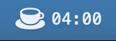
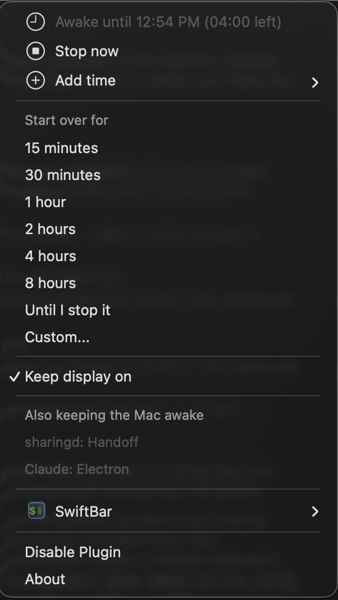

# Caffeinate Timer

Keep your Mac awake for a set time with macOS `caffeinate`, with a live countdown in the menu bar.

| Idle | Active (4 hours left) |
| --- | --- |
|  |  |

## Features

- Coffee cup icon: grey outline when idle, filled amber while active, with an `HH:MM` countdown.
- Keep awake for 15 minutes to 8 hours, until stopped, or a custom time (`90` or `1:30`).
- Add time to a running timer without restarting it by hand.
- "Keep display on" toggle, applied to a running timer straight away.
- Notification when the timer runs out.
- Lists other apps that are currently preventing sleep.
- Only stops the `caffeinate` it started (tracked by PID), so a `caffeinate` you started in a terminal is left alone.

## Settings

Set in xbar's plugin preferences, or as environment variables in SwiftBar:

| Variable | Default | |
| --- | --- | --- |
| `IDLE_COLOR` | `#A8A8A8` | Cup colour when idle |
| `ACTIVE_COLOR` | `#E8A33D` | Cup colour while active |
| `SHOW_OTHERS` | `true` | List other apps preventing sleep |
| `NOTIFY` | `true` | Notify when a timer ends |

## Notes

- Works in xbar and SwiftBar. SwiftBar shows the SF Symbols `cup.and.saucer` / `cup.and.saucer.fill`; xbar has no SF Symbols, so it shows a tinted text cup instead.
- Refreshes once a minute. An idle refresh runs a single `pmset` call (none with `SHOW_OTHERS=false`); everything else uses zsh builtins. `#!/bin/zsh -f` skips shell startup files.
- State lives in SwiftBar's plugin data folder, or `~/Library/Application Support/caffeinate-timer` under xbar.
